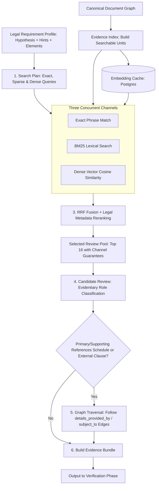
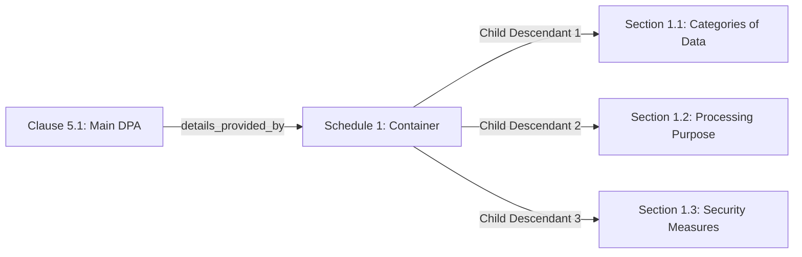

# Analysis Module: Investigation Phase & Hybrid Retrieval Pipeline

> [!NOTE]
> This document details the **Investigation Phase** and **Hybrid Retrieval System** in the Analysis module (`backend/src/modules/analysis/capabilities/act/compliance/investigation/`). It explains how requirements extract, rank, and expand evidence passages directly from the canonical document graph before verification begins.

---

## 1. Executive Summary & Design Principles

The Investigation Phase is responsible for finding **grounded contract evidence** for every legal requirement (e.g. GDPR, CCPA, HIPAA, AI Act, commercial terms) before any verification or legal judgment occurs.

### Core Architectural Pillars
1. **Graph-Native Evidence Units**:
   - Instead of slicing raw text into arbitrary fixed-length chunks (which breaks legal clauses), investigation queries searchable **Evidence Units** derived directly from the canonical document structure graph.
   - Units preserve the clause's ancestral headings, titles, ordinal paths, and bounding boxes.
2. **Three-Channel Hybrid Retrieval**:
   - Concurrently executes three complementary retrieval channels:
     - **Exact Anchors**: Multi-word phrase matching.
     - **Sparse Lexical**: In-memory BM25 with term frequency-inverse document frequency.
     - **Dense Semantic**: Cosine similarity over vector embeddings cached in PostgreSQL.
3. **Reciprocal Rank Fusion (RRF) + Legal Metadata Reranking**:
   - Normalizes and fuses channel ranks, then boosts candidates with legal signals (`operative_modality`, `heading_alignment`, `exact_anchor`) and penalizes mere cross-references or bare definitions.
4. **Evidentiary Role Classification**:
   - Classifies candidates into exact evidentiary roles (`primary`, `supporting`, `dependency`, `limitation`, `contradictory`, `definition`, `context`, `irrelevant`) without deciding compliance prematurely.
5. **Graph-Aware One-Hop Expansion**:
   - If a primary clause references another schedule (e.g., *"details are set forth in Schedule 1"*), the engine traverses the document graph's relation edges (`details_provided_by`, `subject_to`, `incorporates`) and pulls in the operative provisions of that schedule.

---

## 2. End-to-End Investigation Architecture



---

## 3. Pipeline Stages in Detail

### Stage 1: Search Plan Formulation (`build-queries.ts`)
*Source File: [build-queries.ts](../../../../../../../../backend/src/modules/analysis/capabilities/act/compliance/investigation/build-queries.ts)*

Each legal requirement profile (authored in skills like `rule-investigation.ts`) contains:
- `hypothesis`: The proposition to prove (e.g., *"The processor assists the controller in responding to data-subject rights requests"*).
- `evidenceHints`: Target vocabulary and domain phrases (e.g., `["data subject", "assist", "rights request", "supervisory"]`).
- `proofElements`: Atomic elements needed to satisfy the rule.

`buildRequirementSearchPlan(requirement)` partitions these into three targeted query arms:
1. **Exact Queries**: Multi-word phrases with $\ge 2$ words (e.g., `"data subject"`, `"rights request"`).
2. **Sparse Queries (BM25)**: The full hypothesis combined with all individual hints.
3. **Dense Queries (Embeddings)**: The hypothesis combined with exact multi-word key phrases.

---

### Stage 2: Evidence Unit Construction (`evidence-index.ts`)
*Source File: [evidence-index.ts](../../../../../../../../backend/src/modules/analysis/capabilities/act/compliance/investigation/evidence-index.ts)*

Rather than querying unstructured text, `buildEvidenceUnits(graph)` extracts operative leaf nodes from the document structure graph:
- **Eligible Node Kinds**: `clause`, `subclause`, `paragraph`, `list_item`, and individual table rows (`tableRows`).
- **Contextual Search Text**:
  ```ts
  const searchText = [parentHeading, title, node.ordinalPath, rawText]
    .filter(Boolean)
    .join(" ")
    .replace(/\s+/g, " ")
    .trim();
  ```
  *Why this matters*: A list item `(a) notify without undue delay` inherits its parent heading `"Clause 12 - Data Breach Notification"` in its search text, so it matches breach-related queries even if the list item text alone omits the word "breach".
- **Table Row Slicing**: Complex tables (e.g. Subprocessor registries, Annex transfer matrices) are split into individual row units while preserving exact character offsets `[sourceRange]`.

---

### Stage 3: Three-Channel Hybrid Retrieval (`hybrid-retrieval.ts`)
*Source File: [hybrid-retrieval.ts](../../../../../../../../backend/src/modules/analysis/capabilities/act/compliance/investigation/hybrid-retrieval.ts)*

All three channels execute concurrently:

#### 1. Exact Anchor Channel
- Scans `searchText` for multi-word phrases.
- Scores candidates based on query token length ($length + 1$), placing high value on explicit technical legal terms (e.g., *"standard contractual clauses"*).
- Capped at top 8 candidates.

#### 2. Sparse Lexical Channel (In-Memory BM25)
- Implements document-scoped BM25 with term frequency (TF), document frequency (DF), and inverted document frequency (IDF):
  $$\text{IDF}(t) = \ln\left(1 + \frac{N - \text{DF}(t) + 0.5}{\text{DF}(t) + 0.5}\right)$$
- Hyperparameters: $k_1 = 1.2$, $b = 0.75$.
- Capped at top 25 candidates.

#### 3. Dense Semantic Channel (Vector Embeddings)
- Unit vectors are loaded from `evidence_embedding_cache` (or computed via `executeEmbedding`).
- Query embeddings are compared against unit vectors using **cosine similarity**:
  $$\text{Cosine}(A, B) = \frac{A \cdot B}{\|A\| \|B\|}$$
- Capped at top 25 candidates.

---

### Stage 4: Fusion & Legal Metadata Reranking (`hybrid-retrieval.ts`)
*Source File: [hybrid-retrieval.ts](../../../../../../../../backend/src/modules/analysis/capabilities/act/compliance/investigation/hybrid-retrieval.ts#L122-L186)*

Hits across all three channels are fused using **Reciprocal Rank Fusion (RRF)**:
$$\text{FusedScore}(d) = \sum_{c \in \{\text{exact, sparse, dense}\}} \frac{1}{60 + \text{Rank}_c(d)}$$

#### Legal Signal Adjustments
After normalizing RRF scores into $[0, 1]$, the engine applies domain-specific adjustments:

| Adjustment | Weight | Rationale |
| :--- | :---: | :--- |
| `exact_anchor` | `+0.12` | Candidate contains verbatim multi-word legal term. |
| `multi_channel` | `+0.08` | Candidate was found by $\ge 2$ retrieval channels independently. |
| `operative_modality` | `+0.04` | Contains binding language (*"shall"*, *"must"*, *"required to"*, *"is prohibited"*). |
| `heading_alignment` | `+0.05` | Ancestor heading matches core tokens of the legal hypothesis. |
| `primary_namespace` | `+0.02` | Located in the main agreement body rather than an ancillary schedule. |
| `sparse_only_penalty` | `-0.05` | Retrieved only by BM25 (penalizes keyword collisions with low semantic relevance). |
| `mere_reference_penalty` | `-0.08` | Contains reference verbs (*"see"*, *"refer to"*) without operative binding words. |
| `definition_penalty` | `-0.12` | Node is a defined term entry; definitions describe terms, they rarely impose operative obligations. |

#### Channel-Guaranteed Review Pool
`selectReviewPool` picks the top 16 candidates while **guaranteeing at least 1 slot** for the top candidate of each active channel (`exact`, `sparse`, `dense`). This ensures high-similarity dense passages are not crowded out by keyword-heavy clauses, and vice-versa.

---

### Stage 5: Evidentiary Role Classification (`rerank-evidence.ts`)
*Source File: [rerank-evidence.ts](../../../../../../../../backend/src/modules/analysis/capabilities/act/compliance/investigation/rerank-evidence.ts)*

The top review pool is reviewed in batches using a structured LLM classifier (`reviewCandidateBatches`):
- **Role Taxonomy**:
  - `primary`: Directly proves one or more proof elements of the requirement.
  - `supporting`: Partially satisfies or strengthens proof, but is not independently sufficient.
  - `dependency`: Imposes a condition, notice timeline, procedure, or carve-out needed to understand the obligation.
  - `limitation`: Limits liability, narrows assistance, or creates an exception.
  - `contradictory`: Expressly contradicts the legal requirement.
  - `definition`: Defines a technical term.
  - `context` / `irrelevant`: Background text without evidentiary value.
- **Element Mapping**:
  - The model maps each candidate to the exact atomic element it satisfies via `contributesToElementIds: ["D1", "D2"]`.
  - Elements that lack evidence are explicitly marked as `unresolvedElementIds`.

---

### Stage 6: Graph-Aware Reference Expansion (`expand-evidence.ts`)
*Source File: [expand-evidence.ts](../../../../../../../../backend/src/modules/analysis/capabilities/act/compliance/investigation/expand-evidence.ts)*

If a `primary` or `supporting` candidate contains a cross-reference, the engine traverses the document structure graph:



1. **Traversing Priority Relation Edges**:
   - Follows edges: `details_provided_by`, `procedure_provided_by`, `implements`, `incorporates`, `subject_to`, `exception_provided_by`, `limits`, `prevails_over`.
2. **Intelligent Descendant Scoring**:
   - When pointing to a large appendix, rather than taking the first paragraphs blindly, `relevanceScore` matches descendant text against the requirement's vocabulary (hypothesis + proof element descriptions).
   - The most relevant operative provisions of the appendix are pulled into the candidate pool (capped at `MAX_EXPANSIONS = 12`).

---

### Stage 7: Evidence Bundle Assembly (`build-bundle.ts`)
*Source File: [build-bundle.ts](../../../../../../../../backend/src/modules/analysis/capabilities/act/compliance/investigation/build-bundle.ts)*

The final evidence bundle (`RequirementEvidenceBundle`) packages the verified findings for downstream verification:
- `passages`: Array of `EvidencePassage` objects containing:
  - `nodeId`, `rawText`, `sourceRange: [start, end]`, `structuralPath`, `confidence`.
  - `role`: (`primary`, `supporting`, `dependency`, `limitation`, `contradictory`).
  - `contributesToElementIds`: The exact sub-elements this passage proves.
- `coveredElementIds` vs. `unresolvedElementIds`.
- `exclusions`, `dependencies`, `coverageReasons`.
- **Token Budget Protection**: Enforces character and token caps so the downstream verifier receives a clean, complete, and bounded context without context overflow.

---

## 4. Key Data Models

### `EvidenceUnit`
```ts
export interface EvidenceUnit {
  unitId: string;
  nodeId: string;
  documentId: string;
  structuralPath: string;           // "document.schedule_1.clause_2.1"
  title?: string;
  parentHeading?: string;           // "Schedule 1 - Security Standards"
  rawText: string;                  // Verbatim clause text
  searchText: string;               // [Heading + Title + Path + Text]
  sourceRange: [number, number];    // Character offsets in canonicalText
  pageStart?: number;
  pageEnd?: number;
  relationshipScope?: "controller_processor" | "processor_subprocessor" | "unspecified";
}
```

### `RequirementEvidenceBundle`
```ts
export interface RequirementEvidenceBundle {
  bundleId: string;
  requirementId: string;
  packageId: string;
  documentId: string;
  candidateCount: number;
  executionStatus: "complete" | "incomplete" | "degraded";
  investigationComplete: boolean;
  coveredElementIds: string[];
  unresolvedElementIds: string[];
  passages: EvidencePassage[];
  dependencies: string[];
  exclusions: string[];
}
```
