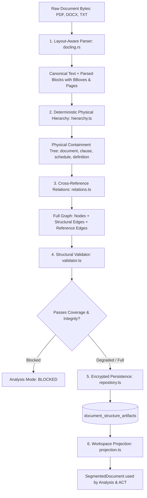
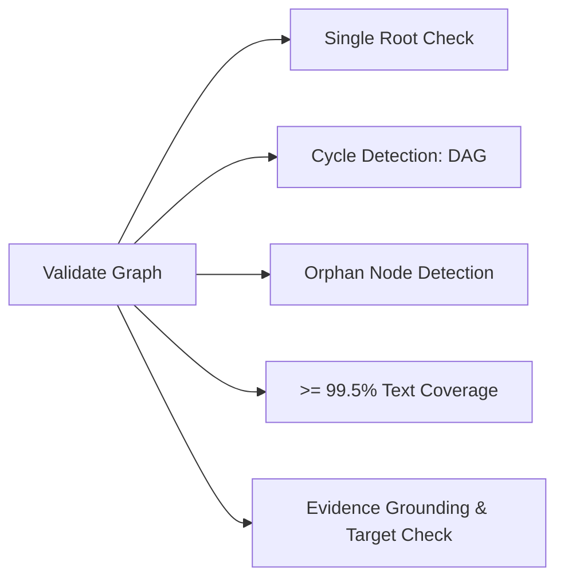

# Analysis Module Document Ingestion Pipeline

> [!NOTE]
> This document details the end-to-end ingestion pipeline in the Analysis module (`backend/src/modules/analysis/capabilities/ingest/document-structure/`). It describes how raw document binaries (PDF, DOCX, TXT, HTML) are transformed into a canonical, immutable **Document Structure Graph** (`CanonicalDocumentGraph`).

---

## 1. Executive Summary & Design Principles

Instead of re-parsing, splitting text on arbitrary token chunks, or guessing document sections during analysis turns, LORA builds a permanent **Canonical Document Structure Graph** once when a document is uploaded.

### Core Design Principles
1. **Separation of Physical Containment & Semantic References**:
   - Physical hierarchy (`parent_of`, `next_sibling`) models how sections, clauses, and lists are formatted.
   - Reference edges (`references` with typed semantic effects) model legal cross-references (e.g., *"details are set forth in Schedule 1"*).
2. **Namespace Isolation**:
   - Standalone schedules, annexes, and appendices are isolated into distinct namespaces (`schedule:1`, `scc`, `appendix:b`).
   - A clause numbered `1.1` in Schedule 1 will never mistakenly bind to clause `1` of the main agreement.
3. **Deterministic Truth with Optional Semantic Enhancement**:
   - Physical layout, numbering hierarchies, and explicit regex-based cross-references are 100% deterministic and require zero LLM calls.
   - Optional LLM relation discovery and ambiguous reference adjudication operate strictly by exception.
4. **Strict Integrity Gate ($\ge 99.5\%$ Text Coverage)**:
   - Automated legal analysis is strictly blocked if the graph has cycles, orphan nodes, or fails to cover at least $99.5\%$ of the document text.

---

## 2. End-to-End Pipeline Architecture



---

## 3. Pipeline Stages in Detail

### Stage 1: Layout-Aware Parsing
*Source File: [parser.ts](../../../../../../../backend/src/modules/analysis/capabilities/ingest/document-structure/parser.ts)*

The entry point determines document format and routes to the appropriate parsing engine:
- **Rich Layout Documents (`PDF`, `DOCX`, `DOC`, `HTML`, `CSV`)**:
  - Processed using `docling.rs` (native Rust bindings with PDFium, Heron ONNX layout model, OCR, and TableFormer).
  - Traverses the Docling element tree starting from `#/body`.
  - For each element, extracts:
    - `label`: `title`, `section_header`, `paragraph`, `list_item`, `table`, `picture`.
    - `level`: Heading level (1, 2, 3...).
    - `text`: Verbatim text content.
    - `prov`: Physical provenance including page number (`page_no`), character spans (`charspan`), and exact bounding boxes (`bbox: {left, top, right, bottom}`).
    - `table`: Full 2D cell grid (`rows`, `columns`, `cells`, `rowSpan`, `columnSpan`, `columnHeader`).
- **Plain Text / Markdown (`TXT`, `MD`)**:
  - Uses the native text document reader, splitting lines and tracking character offsets.

**Output Artifact**:
- `canonicalText`: A single, contiguous string representation of the entire document text.
- `ParsedBlock[]`: A flat, document-ordered array of parsed items with global character ranges `sourceRange: [start, end]`.

---

### Stage 2: Deterministic Physical Hierarchy
*Source File: [hierarchy.ts](../../../../../../../backend/src/modules/analysis/capabilities/ingest/document-structure/hierarchy.ts)*

This stage converts raw `ParsedBlock[]` items into a legal document tree:

#### 1. Root Node Creation
Initializes a root node (`kind: "document"`, `ordinalPath: "document"`, `namespace: "main"`).

#### 2. Legal Classifier (`markerFor`)
Inspects each block using deterministic legal grammar patterns:
- **Boundary Headings**:
  ```ts
  const BOUNDARY_RE = /^(appendix|schedule|annex|exhibit)\s+([a-z0-9]+(?:[.-][a-z0-9]+)*)/i;
  ```
  Matches `"Schedule 2 - Security Measures"` $\rightarrow$ sets `kind: "schedule"`, `boundary: true`, starts a new namespace segment (`schedule:2`).
- **Explicit Numbered Provisions**:
  ```ts
  const EXPLICIT_NUMBER_RE = /^(clause|section|article)\s+(\d+(?:\.\d+)*(?:\([a-zivxlcdm]+\))?)/i;
  ```
  Matches `"Clause 12.1"` $\rightarrow$ sets `kind: "clause"`, `displayLabel: "12.1"`, `numberingPath: ["12", "1"]`.
- **Numeric Provisions**:
  ```ts
  const NUMBER_RE = /^(\d+(?:\.\d+)*(?:\([a-zivxlcdm]+\))?)/i;
  ```
  Matches `"2.1.3 Audit Rights"` $\rightarrow$ sets `kind: "subclause"`, `displayLabel: "2.1.3"`.
- **Enumerated Lists**:
  ```ts
  const LIST_RE = /^\(([a-z]|[ivxlcdm]+|\d+)\)\s+(.+)$/i;
  ```
  Matches `"(a) notify the Controller without undue delay"` $\rightarrow$ sets `kind: "list_item"`, `displayLabel: "(a)"`.
- **Defined Terms**:
  ```ts
  // Recognizes: "Personal Data" means... / Confidential Information: ...
  ```
  Creates scoped definitions (`ScopedDefinition`) linked to the definition node.

#### 3. Parent-Child Resolution Logic
To attach each node to its correct parent:
- **Longest Numeric Prefix Matching**:
  - Clause `2.1.3` extracts parent label `2.1`.
  - Looks up `numberIndex.get("main|2.1")`. If found, node `2.1` becomes `parentId`.
- **Namespace Isolation**:
  - When in namespace `schedule:2`, parent lookups are scoped exclusively to `schedule:2|...`.
- **Heading Stacks (`headingStack`)**:
  - For non-numbered prose sections, heading nesting is governed by Docling's `level` ($h1 \rightarrow h2 \rightarrow h3$).
- **List Stacks (`listStack`)**:
  - Nests sub-lists based on legal ranking (numeric `1` $\rightarrow$ letter `(a)` $\rightarrow$ roman `(i)`).

#### 4. Structural Edge Generation
- `parent_of`: Direct link from parent node to child node.
- `next_sibling`: Link between consecutive sibling nodes under the same parent.

---

### Stage 3: Cross-Reference & Relation Graph
*Source Files: [relations.ts](../../../../../../../backend/src/modules/analysis/capabilities/ingest/document-structure/relations.ts), [llm-relations.ts](../../../../../../../backend/src/modules/analysis/capabilities/ingest/document-structure/llm-relations.ts), [adjudication.ts](../../../../../../../backend/src/modules/analysis/capabilities/ingest/document-structure/adjudication.ts)*

While Stage 2 establishes physical nesting, Stage 3 connects semantic cross-references:

#### 1. Regex Reference Detection
Scans provision texts for explicit references:
- **Internal**: `"clauses 12.1 through 12.4"`, `"subject to Clause 8"`
- **Qualified**: `"clause 4 of Schedule 2"`, `"paragraph 3 of Annex I"`
- **External**: Legal regimes like `"GDPR Article 28"`, `"CCPA Section 1798.140"`

#### 2. Semantic Effect Tagging
Contextual language assigns a typed legal relationship:

| Semantic Effect | Trigger Keywords / Examples |
| :--- | :--- |
| `details_provided_by` | *"details are set forth in"*, *"specified in Schedule B"* |
| `subject_to` | *"subject to Clause 12"*, *"conditional upon"* |
| `exception_provided_by`| *"except as provided in"*, *"carve-out in"* |
| `prevails_over` | *"in the event of conflict, this DPA shall prevail"* |
| `defined_by` | *"as defined in Section 1"*, *"has the meaning given in"* |
| `incorporates` | *"hereby incorporated by reference"* |
| `limits` | *"limited by Clause 9"* |
| `survives` | *"shall survive termination in accordance with"* |

#### 3. Target Resolution & Virtual Targets
- Resolves target `nodeId` in the corresponding namespace.
- **Unresolved Virtual Targets**: If the agreement references an external or missing annex (e.g., *"Exhibit C"* not uploaded), it connects to `unresolved://exhibit/c` as an `UnresolvedTarget`, maintaining reference truth without fabricating nodes.

#### 4. Optional Semantic Discovery & Adjudication
- `DOCUMENT_GRAPH_LLM_RELATIONS=1`: Gemini discovers subtle semantic relationships beyond regex syntax.
- `DOCUMENT_GRAPH_LLM_ADJUDICATION=1`: Ambiguous cross-references with multiple possible targets undergo automated review-by-exception.

---

### Stage 4: Structural Quality & Integrity Validation
*Source File: [validator.ts](../../../../../../../backend/src/modules/analysis/capabilities/ingest/document-structure/validator.ts)*

Before saving to the database, `validateDocumentGraph` enforces strict data-integrity gates:



- **$\ge 99.5\%$ Text Coverage**: Non-whitespace characters in `canonicalText` must be $\ge 99.5\%$ covered by node ranges.
- **Cycle Detection**: Traverses children to ensure zero circular parentage.
- **Single Root & Zero Orphans**: Must have exactly one root (`document`); every child must have a valid `parentId`.
- **Evidence Grounding**: Every `RelationEdge` must match an exact substring in its source node and target an existing node or registered unresolved target.

#### Analysis Mode Output
Depending on issues detected:
- **`analysisMode: "full"`**: All checks pass; full analysis enabled.
- **`analysisMode: "degraded"`**: Minor non-fatal issues (e.g. ambiguous references remain); analysis proceeds on verified structure only with limitation warnings.
- **`analysisMode: "blocked"`**: Fatal integrity issue (cycles, text coverage $< 99.5\%$, orphan nodes); analysis halts safely.

---

### Stage 5: Encrypted Persistence & Workspace Projection
*Source Files: [repository.ts](../../../../../../../backend/src/modules/analysis/capabilities/ingest/document-structure/repository.ts), [projection.ts](../../../../../../../backend/src/modules/analysis/capabilities/ingest/document-structure/projection.ts)*

- **Database Persistence**:
  - Stored in PostgreSQL table `document_structure_artifacts`.
  - Payloads are encrypted using AES-256-GCM.
  - Indexed by `version_id`, `schema_version`, and `parser_version` for instant reuse.
- **Workspace Projection (`projection.ts`)**:
  - When an analysis job starts, `graphToWorkspaceDocument(graph)` projects the graph into standard workspace objects (`SegmentedDocument`):
    - Converts nodes into clean `DocumentSegment[]` records with human-readable structural paths (`document.schedule_2.clause_4`).
    - Provides exact character spans (`charRange`) for pinpoint evidence citation in compliance reports.

---

## 4. Key Data Models

### `StructuralNode`
```ts
export interface StructuralNode {
  nodeId: string;                // Deterministic SHA-256 hash
  kind: StructuralNodeKind;      // "clause", "subclause", "schedule", "definition", etc.
  parentId?: string;             // Parent container node ID
  childIds: string[];            // Child node IDs in document order
  order: number;                 // Document sequential order
  namespace: string;             // "main", "schedule:2", "scc", etc.
  ordinalPath: string;           // "document.schedule_2.clause_4.subclause_4.1"
  displayLabel?: string;         // e.g. "4.1", "(a)", "Schedule 2"
  numberingPath?: string[];      // e.g. ["4", "1"]
  title?: string;                // e.g. "Audit and Inspection Rights"
  text: string;                  // Verbatim clause text
  sourceRange: [number, number]; // [charStart, charEnd] in canonicalText
  provenance: SourceProvenance[];// Page number, bounding box coordinates
  confidence: number;            // Extraction confidence (0.9 to 1.0)
  signals: string[];             // Internal detection signals
  definedTerm?: string;          // Extracted defined term, if applicable
  table?: CanonicalTable;        // Structured table data, if applicable
}
```

### `RelationEdge`
```ts
export interface RelationEdge {
  edgeId: string;
  sourceNodeId: string;
  targetNodeId?: string;
  unresolvedTargetId?: string;
  candidateTargetIds: string[];
  targetMention: string;
  edgeType: "references";
  semanticEffect: RelationSemanticEffect; // "details_provided_by", "subject_to", etc.
  evidenceText: string;
  evidenceRange: [number, number];
  explicit: boolean;
  status: "resolved" | "ambiguous" | "unresolved_internal" | "external";
  reason: string;
  detectedBy: Array<"deterministic_rule" | "llm_discovery">;
  verifiedBy: Array<"target_resolver" | "graph_validator" | "llm_adjudicator">;
}
```

---

## 5. Configuration Environment Variables

| Variable | Default | Purpose |
| :--- | :--- | :--- |
| `DOCLING_RS_HOME` | `process.cwd()` | Directory containing `.models` and `.pdfium` assets for PDF parsing. |
| `DOCLING_SERVICE_URL` | unset locally | Authenticated HTTPS Docling service URL; required in production. |
| `DOCLING_SERVICE_TOKEN` | unset locally | Shared bearer token for the Docling service; required in production. |
| `DOCUMENT_GRAPH_LLM_RELATIONS` | `0` (off) | Set to `1` to enable LLM semantic relation discovery for non-regex references. |
| `DOCUMENT_GRAPH_RELATION_BATCH_CHARS` | `18000` | Max character batch size sent during semantic discovery. |
| `DOCUMENT_GRAPH_RELATION_CONCURRENCY` | `2` | Maximum concurrent semantic discovery calls (capped at 2). |
| `DOCUMENT_GRAPH_LLM_ADJUDICATION` | `0` (off) | Set to `1` to enable automated review-by-exception for ambiguous references. |
| `DOCUMENT_GRAPH_ADJUDICATION_LIMIT` | `40` | Maximum ambiguous relations adjudicated per document (max 100). |
